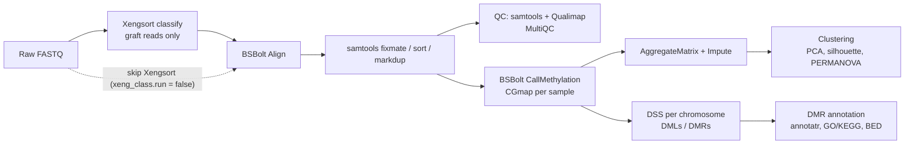

# PDX Methyl-seq pipeline

Snakemake workflow for **EM-seq / WGBS** data from **patient-derived xenografts (PDX)**.
It removes mouse (host) reads with Xengsort, aligns the human (graft) reads with BSBolt,
calls CpG methylation, builds an imputed methylation matrix and runs downstream analyses:
unsupervised clustering, differential methylation with DSS and DMR annotation/enrichment.



## Repository structure

```
.
├── config/
│   ├── config.yml               # All paths and parameters
│   └── metadata_example.tsv     # Metadata format example
├── workflow/
│   ├── Snakefile                # Entry point: global config, sample discovery, target rule
│   ├── rules/
│   │   ├── xengsort_index.smk   # (optional) human/mouse k-mer index
│   │   ├── xengsort_class.smk   # host/graft read sorting + MultiQC
│   │   ├── BSBolt_index.smk     # (optional) BSBolt index
│   │   ├── BSBolt_AlignCall.smk # alignment, BAM processing, QC, methylation calling
│   │   ├── BSBolt_matrix.smk    # matrix aggregation + kNN imputation
│   │   └── MethylAnalysis.smk   # clustering, DSS, merge, DMR annotation
│   └── scripts/
│       ├── Clustering_analysis.R
│       ├── Differential_DSS.R
│       └── DMR_annotation.R
├── LICENSE
└── README.md
```

## Prerequisites & Software

Software is provided through three Snakemake deployment methods, so all three must be
enabled when running the workflow (see [Running the pipeline](#running-the-pipeline)):

| Tool | Deployment | Config key |
|---|---|---|
| Xengsort 2.2.x | Apptainer image | `app.xengsort` |
| BSBolt 1.6.0 | Apptainer image | `app.bsbolt` |
| Qualimap 2.3 | Apptainer image | `app.qualimap` |
| MultiQC | Snakemake wrapper `v9.15.0/bio/multiqc` (conda) | – |
| samtools | Environment module | `modules.samtools` |
| R ≥ 4.3 + pandoc | Environment module | `modules.r` |

R packages: `tidyverse`, `data.table`, `optparse`, `bsseq`, `DSS`, `PCAtools`, `cluster`,
`factoextra`, `ggsci`, `vegan`, `pairwiseAdonis` (GitHub), `plotly`, `htmlwidgets`, `sva`,
`annotatr`, `GenomicRanges`, `clusterProfiler`, `org.Hs.eg.db`,
`TxDb.Hsapiens.UCSC.hg38.knownGene` (or `hg19`), `scales`.

<details>
<summary><b>Click to expand installation steps</b></summary>

### 1. Clone the repository

```bash
git clone <gitlab-url>/pdx-methylseq.git
cd pdx-methylseq
```

### 2. Install Snakemake

```bash
mamba create -c conda-forge -c bioconda -n snakemake "snakemake>=8" snakemake-executor-plugin-slurm
mamba activate snakemake
```

### 3. Install the R packages

The scripts install missing packages on first run, but compute nodes often have no
internet access, so install them beforehand with the R provided by `modules.r`:

```r
install.packages(c("BiocManager", "remotes"))
BiocManager::install(c("tidyverse", "data.table", "optparse", "bsseq", "DSS", "PCAtools",
                       "cluster", "factoextra", "ggsci", "vegan", "plotly", "htmlwidgets",
                       "sva", "annotatr", "GenomicRanges", "clusterProfiler", "org.Hs.eg.db",
                       "TxDb.Hsapiens.UCSC.hg38.knownGene", "scales"))
remotes::install_github("pmartinezarbizu/pairwiseAdonis/pairwiseAdonis")
```

### 4. (HPC without internet on compute nodes) Pre-build the MultiQC environment

```bash
snakemake --configfile config/config.yml --sdm conda --conda-create-envs-only
```

If the cluster has no access to GitHub, clone `https://github.com/snakemake/snakemake-wrappers`,
check out tag `v9.15.0` and add `--wrapper-prefix file:///path/to/snakemake-wrappers/`.

</details>

> KEGG enrichment queries the KEGG REST API; if the node has no internet access it is
> skipped with a message in the log (GO enrichment is unaffected).

## Configuration

Copy and edit `config/config.yml`. The main blocks are:

- **`proj`** – `ref_dir` (references), `proj_dir` (results go to `<proj_dir>/analysis`),
  `raw_dir` (FASTQs) and `containers_dir`.
- **`app`** – container images, relative to `containers_dir`, absolute, or URIs (`docker://…`).
- **`modules`** – environment module names for samtools and R on your cluster.
- **`xeng_index` / `xeng_class`** – Xengsort index building and classification.
  Set `xeng_index.run: true` to build the index; otherwise the index must exist at
  `<ref_dir>/<out_dir>/xengsort-<data_type>-k<k>` or at `xeng_class.index` if given.
- **`bsbolt_index` / `bsbolt_call`** – BSBolt index building, alignment and calling.
  `discard` removes samples from every step (useful after reviewing the Xengsort report).
- **`bsbolt_matrix`** – coverage/sample filters and kNN imputation parameters.
- **`downstream`** – metadata file and the variable to test (see below).

### Reference files

Paths are relative to `ref_dir`:

- `xeng_ref.dna_human` / `xeng_ref.dna_mouse`: human and mouse genomic FASTAs to build the
  Xengsort index (`cdna_*` are only used for RNA-seq indexes). Not needed if the index already exists.
- `bsbolt_index.ref_genome`: human FASTA used to build the BSBolt index. Not needed if
  `bsbolt_call.index_dir` already contains an index.

### Input FASTQs

Samples are discovered from the R1 pattern (`{sample}` wildcard) inside `raw_dir`:

```yaml
xeng_class:
    r1_pattern: "{sample}_R1.fastq.gz"            # flat layout
    # r1_pattern: "{sample}/{sample}_1.fq.gz"     # one folder per sample
```

If reads are already free of mouse contamination, set `xeng_class.run: false` and
fill `bsbolt_call.in_dir` / `r1_pattern` / `r2_pattern` instead.

### Metadata

Tab-separated file with one row per sample (see `config/metadata_example.tsv`):

| Column | Purpose |
|---|---|
| `samples_col` (e.g. `SampleID`) | must match the `{sample}` names of the FASTQs |
| `var` (e.g. `KRAS`) | two-level grouping for DSS; samples with `NA` are excluded |
| `batch_var` (optional) | batch column for ComBat correction before clustering |

`test_group` must be one of the two levels of `var`. DSS differences are computed as
**test − reference**, so `Hypermethylated_in_<test_group>` means higher methylation in the
test group.

## Running the pipeline

### Execution

Check the DAG and paths with a dry-run first:

```bash
snakemake --configfile config/config.yml -n
```

Run up to the Xengsort QC, inspect host contamination and fill `bsbolt_call.discard` if needed:

```bash
snakemake --configfile config/config.yml --profile slurm \
    --sdm conda apptainer env-modules --until xengsort_multiqc
```

Then run the whole workflow on a Slurm cluster:

```bash
snakemake --configfile config/config.yml --profile slurm \
    --sdm conda apptainer env-modules
```

### Slurm profile

The profile sets partition, account, default resources and Apptainer bind mounts.
Every directory used in the config must be bound into the containers. Example
`slurm/config.yaml`:

```yaml
executor: slurm
jobs: 50
software-deployment-method:
  - conda        # MultiQC wrapper
  - apptainer    # Xengsort, BSBolt, Qualimap
  - env-modules  # samtools, R
apptainer-args: "--bind /path/to/data"
default-resources:
  slurm_partition: "<partition>"
  mem_mb: 8000
```

Find more information in the
[Snakemake documentation](https://snakemake.readthedocs.io/en/stable/executing/cli.html#profiles).

### Running the R scripts standalone

Each script also works outside Snakemake (`Rscript <script> --help`), e.g.:

```bash
Rscript workflow/scripts/Differential_DSS.R \
  --metadata metadata.tsv --samples_col SampleID \
  --indir analysis/02_BSBolt/03_CallMethylation --outdir dss_chr1 \
  --chrom chr1 --var KRAS --test_group MUT
```

## Outputs

All results are written to `<proj_dir>/analysis/`:

```
analysis/
├── 01_Xengsort/                      # only if xeng_class.run: true
│   ├── <sample>/<sample>-{graft,host,both,neither,ambiguous}.{1,2}.fq.gz
│   └── multiqc_report.html
├── 02_BSBolt/                        # 01_BSBolt/ if Xengsort is skipped
│   ├── 01_Alignment/<sample>/<sample>_dedup.bam(.bai)
│   ├── 02_Align_QC/multiqc_report.html
│   └── 03_CallMethylation/
│       ├── <sample>/<sample>_meth.CGmap.gz
│       ├── methyl_matrix.tsv
│       └── methyl_matrix_imputed.tsv
└── 03_MethylAnalysis/
    ├── 01_Clustering/k_<best|N>/     # PCA, silhouette, PERMANOVA, cluster assignments
    ├── 02_Diff_Methyl/               # per-chromosome DSS results + merged DML/DMR tables
    └── 03_DMR_annotation/            # filtered/annotated DMRs, plots, GO/KEGG, BED for HOMER
```

## Method notes

- **Xenograft filtering**: only reads classified as `graft` are kept; `both`, `neither` and
  `ambiguous` are discarded to avoid coverage-correlated confounders.
  For bisulfite/EM-seq data, Xengsort is run with a bisulfite-aware index (`data_type: wgbs`).
- **Duplicates**: marked with `samtools markdup` after `fixmate -m` (flagged, not removed)
  before methylation calling.
- **Matrix**: CpGs covered ≥ `min_cov` in ≥ `min_sample` of samples; values are methylation
  proportions in [0, 1]; missing values are imputed with BSBolt kNN (`window_size`, `kneighbors`).
- **Clustering**: sites with no missing values and non-zero variance, optional ComBat,
  then a chi-square test keeps sites with variance above the median (BH q < 0.05).
  PCs up to the scree elbow (minimum 2) are clustered with k-means, Ward hierarchical and
  PAM; method and k are chosen by mean silhouette (or k fixed with `clust_k`) and validated
  with PERMANOVA (`adonis2`, `pairwiseAdonis`).
- **Differential methylation**: DSS `DMLtest` with smoothing on CpGs covered
  ≥ `dss_min_cov` in every sample; DMLs/DMRs with `p < 0.05`, `delta = 0.1`.
  Chromosomes without data (e.g. chrY in female samples) produce empty tables instead of failing.
- **DMR filtering**: `nCG ≥ 5`, `|diff.Methy| ≥ 0.1`, `|areaStat| ≥ 100`; annotated with
  annotatr (CpG context + basic gene features). GO BP / KEGG enrichment uses genes with
  promoter DMRs, separately for hyper- and hypomethylated DMRs.

## Citation

If you use this workflow, please cite the underlying tools:
Snakemake, Xengsort, BSBolt, samtools, Qualimap, MultiQC, DSS, bsseq, annotatr,
clusterProfiler, vegan and sva.

## License

This project is licensed under the **MIT License** – see the [LICENSE](LICENSE) file for details.
It grants free permission to use, modify, distribute and commercially exploit the software,
provided the original copyright notice is preserved.


